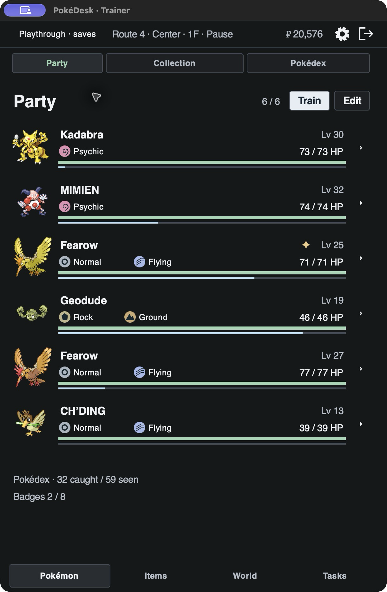
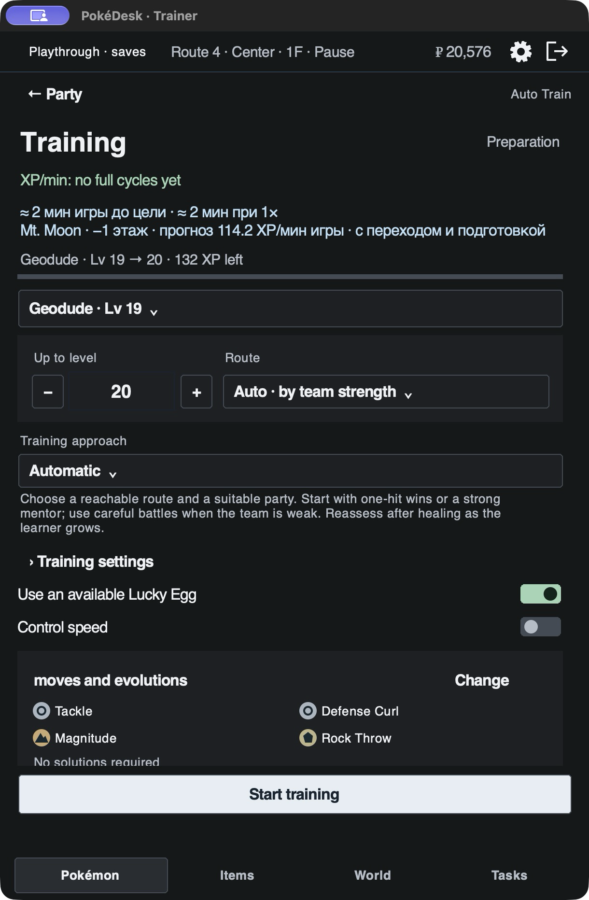
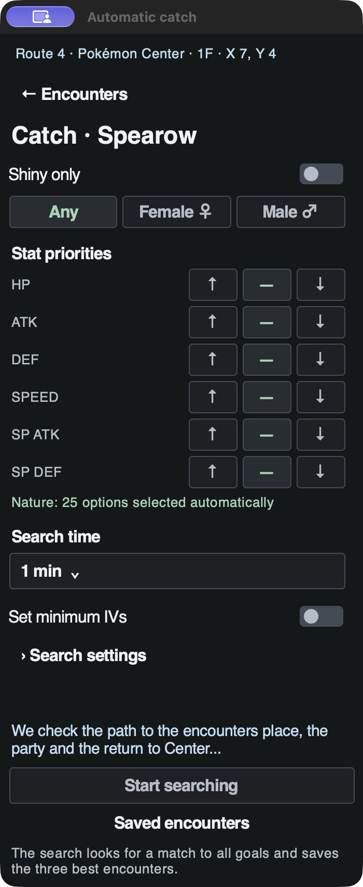

# PokéDesk

[](https://github.com/redmoongames/pokedesk/actions/workflows/ci.yml)
[](LICENSE)
[](https://www.python.org/downloads/)
[](docs/SOURCE_SETUP.md)

A local desktop companion for Pokémon Gen III: play in one window, inspect your
party in another, and run Python automation against the live emulator session.

[Русская инструкция](docs/README.ru.md) · [Setup](docs/SOURCE_SETUP.md) ·
[Architecture](docs/architecture.md) · [Contributing](CONTRIBUTING.md)

**Status: source preview.** The private playable installation targets Apple
Silicon Macs. This repository contains the application source and native adapter
source, but **does not yet include a complete clean-machine installer**. Cloning
it and adding a ROM is not enough to play. Python packages built here are source
packages, not a bundled emulator application.

## What it does

- **Party and collection:** HP/XP, types, statuses, moves, evolutions and reference views.
- **Training:** route and party selection, healing, move/evolution decisions, and cycle history.
- **Encounter search:** species, gender, shiny and stat preferences; optional exact IVs,
  timed searches, ranked candidates and parallel search workers.
- **Python scripting:** control the current session through the SDK, with guarded input
  and **F9 manual takeover**.
- **Save handling:** separate playthroughs, slots, autosaves, rollback checkpoints and history.
- **Local execution:** emulator ownership stays off the UI thread; jobs pin their code,
  Python, native libraries and references so source updates do not change active runs.

Automation depends on the edition, supported maps and current story progress.
FireRed is the main validation path. LeafGreen, Ruby and Sapphire adapters are
also present; this does not imply every map or event is covered. ROM hacks and
arbitrary revisions are not supported.

## Screenshots

Real application windows from a disposable demo session. The images show setup
screens; they do not represent a running search or a measured training result.

<p align="center"></p>

| Training setup | Encounter search |
| --- | --- |
|  |  |

Game artwork visible in screenshots belongs to its respective rights holders.
Screenshots are documentation, not a game resource pack, and are not covered by
the license for the application's original code.

## Download and check the source

Download Python **3.12 or 3.13** from [python.org](https://www.python.org/downloads/macos/)
for the tested public-check environment. Git can be obtained through Apple's
Command Line Tools (`xcode-select --install`), or use **Code → Download ZIP** here.

```sh
git clone https://github.com/redmoongames/pokedesk.git
cd pokedesk
python3 -B tools/public_checks.py
```

This checks public contracts and verifies a fresh, allowlisted source export.
It needs no ROM, save, Tk window or native emulator. The public GitHub Actions
workflow checks these contracts and builds/verifies wheel and sdist artifacts
on Linux and macOS. It does not run the complete game integration suite.

Optional editable source installation:

```sh
python3 -m venv .venv
.venv/bin/python -m pip install -e .
.venv/bin/pokedesk --help
```

## Run the game

You need a **separately prepared, compatible private PokéDesk installation**.
There is currently no public download for the complete resource/runtime pack.
The required components and their sources are listed in [setup](docs/SOURCE_SETUP.md):

| Required locally | Included here? |
| --- | --- |
| Your own supported English game ROM | No |
| Compatible mGBA core and this project's native bridge | Adapter source only |
| Bundled Apple Silicon Python/Tk runtime | No |
| Edition-specific symbols and compiled reference/navigation packs | No |
| Optional sprites and private integration fixtures | No |

The native bridge is tied to a pinned [mGBA](https://github.com/mgba-emu/mgba)
ABI. Installing the standalone mGBA or RetroArch application does not supply a
compatible PokéDesk installation. `native/build.py` rebuilds the adapter against
an already prepared core; it is not a complete dependency installer.

On a prepared installation, preserve the whole portable folder, including its
runtime and resources, and use its normal launcher. A source-installed command
can select that installation explicitly:

```sh
.venv/bin/pokedesk --root PATH_TO_PRIVATE_INSTALLATION
```

FireRed's primary supported ROM is **English USA/Europe revision 1**, 16 MiB,
SHA-1 `dd5945db9b930750cb39d00c84da8571feebf417`. The prepared installation expects
it at `Data/FireRed.gba`. Other edition revisions are defined in
[src/pokemon_red/editions.py](src/pokemon_red/editions.py). Obtain ROMs yourself;
this project provides neither ROM downloads nor ROM download instructions.

Start with a separate playthrough, choose a Pokémon in **Party → Train**, or
open encounter search from a species page. Review the plan before starting.
Press **F9** to take control back. Input and speed hotkeys can be edited in Settings.
Custom scripts run as ordinary trusted Python programs with your user permissions.

## Save and update boundaries

`Data`, `Profiles` and `Sessions` are private local data. Back them up with the
portable installation. Version snapshots live under `Sessions/installations`;
restart normally to activate a code update. Old versions are retained for active
and resumable jobs; automatic cache collection is not implemented yet.

The repository and package export deliberately exclude ROMs, saves, prepared
states, journals, logs, extracted references, runtime/native binaries and sprite
packs. Documentation screenshots are a narrow, explicit exception for images.
Do not upload a working installation as a repository or attach it to an issue.

## Development

See [CONTRIBUTING.md](CONTRIBUTING.md) and [AGENTS.md](AGENTS.md) before changing
runtime or safety code. The core has one owner; F9 uses a separate revocation
path; saves are published through ordered durability barriers.

Source export, package verification, reference preparation and private integration
checks are documented in [setup](docs/SOURCE_SETUP.md). Full integration tests
require local native libraries, reference packs, a supported ROM and private
fixtures. Missing resources are not a successful game validation.

## License and credits

Original PokéDesk code is licensed under [Apache 2.0](LICENSE). This permissive
license includes an explicit patent grant; its authoritative terms are in the
[Apache license text](https://www.apache.org/licenses/LICENSE-2.0).
[NOTICE](NOTICE) and [THIRD_PARTY_NOTICES.md](THIRD_PARTY_NOTICES.md) document
third-party boundaries. mGBA and other dependencies retain their own licenses.

Pokémon ROMs, game data, artwork and trademarks are not licensed by this project.
PokéDesk is independent and unaffiliated with Nintendo, Game Freak or The Pokémon Company.
