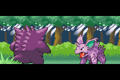
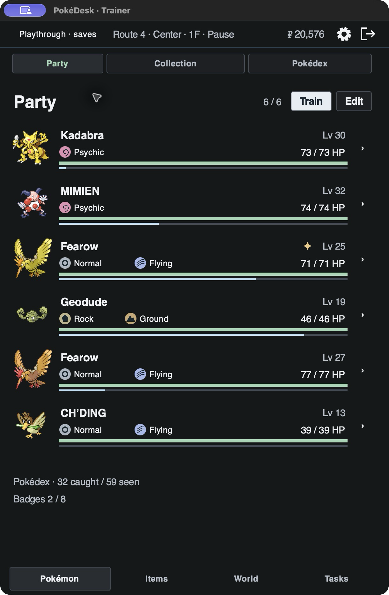
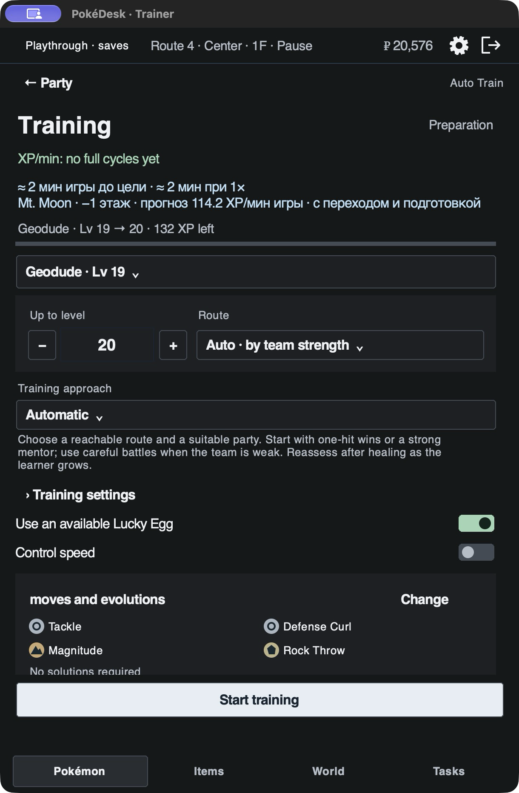
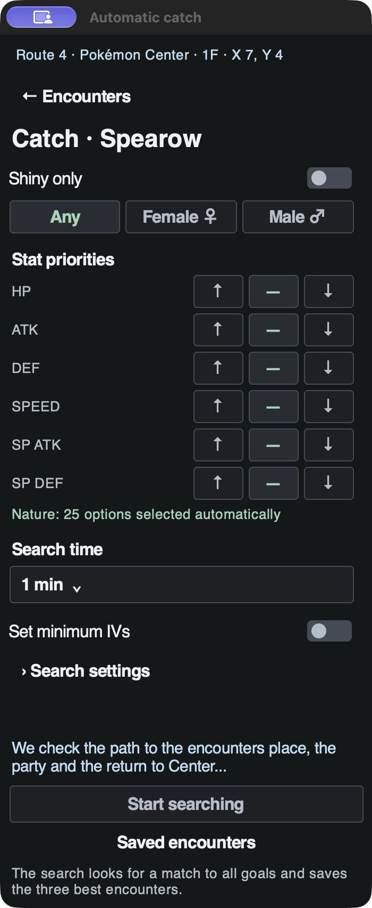

# PokéDesk — Pokémon FireRed for Mac, with automation

[](https://github.com/redmoongames/pokedesk/actions/workflows/ci.yml)
[](https://github.com/redmoongames/pokedesk/releases/tag/v0.1.0-beta.1)
[](LICENSE)

Play Pokémon FireRed in a dedicated game window. Inspect your party, train toward
a target level, search for Pokémon with preferred IVs/natures, or write Python
scripts that control the running game. **F9 takes control back from the bot.**

**[Download for Mac with an M chip](https://github.com/redmoongames/pokedesk/releases/download/v0.1.0-beta.1/PokeDesk-0.1.0-beta.1-macos-arm64.dmg)** ·
[Русская инструкция](docs/README.ru.md) · [Release notes](https://github.com/redmoongames/pokedesk/releases/tag/v0.1.0-beta.1) · [Build from source](docs/SOURCE_SETUP.md)

**Public beta.** The app bundles Python/Tk and mGBA; no Terminal, Homebrew, CUDA,
external emulator, API key or cloud account is needed to play. Supply your own
supported cartridge. The app is ad-hoc signed, **not Apple-notarized**; the first
opening may require the macOS steps below.

## Start playing

1. Download the DMG, open it, and drag **PokeDesk.app** into **Applications**.
2. Open PokéDesk and click **Choose ROM…**. Select your English **FireRed Rev 1**
   `.gba` file. The app checks it and prepares local references and pixel sprites.
3. Click **Begin**, or choose **File → Continue / Begin**. Use **+ New playthrough**
   for a separate adventure; intro skipping and starter search are optional.

If macOS blocks the app, first try opening it, then use **System Settings →
Privacy & Security → Open Anyway** for PokéDesk if you trust this release.
[Apple explains this first-opening flow](https://support.apple.com/en-us/102445).
No command-line security changes are required. Managed Macs may prohibit this.

Requirements: **Apple Silicon (M-series), macOS 13 or newer**, and a supported ROM.
Intel Macs, Windows and Linux are not supported by this binary release. Support
is based on the architecture/deployment target and local testing, not a test on
every macOS release or every M-series model.

## What it looks like

The game has its own window; the trainer panel and encounter/battle context open
beside it. These are actual game/interface images from disposable local sessions.

<p align="center"></p>
<p align="center"></p>

| Training setup | Encounter search |
| --- | --- |
|  |  |

The setup screenshots are not measured training/search results. Some secondary
reference text is still being localized. Game artwork belongs to its respective
rights holders; screenshots are documentation, not a distributable game pack.

## Your cartridge

A **ROM** is a digital copy of a cartridge. Choose an unpacked **`.gba`** file;
`.sav` is a save file, and a ZIP archive is not a cartridge.

This release supports **Pokémon FireRed, English USA/Europe revision 1 (v1.1)**:

- Size: **16 MiB / 16,777,216 bytes**.
- SHA-1: `dd5945db9b930750cb39d00c84da8571feebf417`.
- The app checks the header, revision, size and full hash automatically.
- Translations, ROM hacks, other revisions and LeafGreen ROMs are rejected.

Supply a cartridge image yourself; no Pokémon ROMs or saves are included here.
For example, a compatible cartridge reader and
[FlashGBX](https://github.com/lesserkuma/FlashGBX) can back up your own GBA
cartridge. A reader produces a ROM file, not a PokéDesk dependency installer.

PokéDesk makes a private local ROM copy and extracts game tables and small sprites
from it during setup. **The ROM is never uploaded.** Preparation works offline.

## Controls

| Action | Default keys |
| --- | --- |
| Move | Arrow keys or WASD |
| GBA A / confirm | X or E |
| GBA B / back | Z or Q |
| Start | Enter |
| Select | Right Shift |
| Pause / resume | Space; 0 sets zero speed |
| Stop the bot and take control | **F9** |
| Stop and pause | Escape |

On Macs using media keys, use **Fn/Globe + F9** if needed. Buttons have up to two
physical-key bindings, independent of the keyboard layout. Change them and the
0–9 speed presets in **Settings**. Sound is off by default.

## Train, search, inspect

- **Party → Auto Train:** choose your Pokémon and target level. Review the route,
  team and move/evolution decisions, then start. Progress includes XP per real
  minute and completed healing-to-healing cycles.
- **Pokémon → Auto Catch:** choose a species, shiny/gender preferences, stat
  priorities and a time budget. Optional exact IV goals and parallel workers
  help compare ranked candidates. Adopting an earlier candidate can roll back
  later progress; the app asks before a destructive rollback.
- **Party and references:** pixel sprites, HP/XP, status, types, moves, evolution
  conditions, collection and encounter information.
- **Python scripts:** run against the live session using the bundled SDK.
  Scripts are trusted local code with your user permissions, not a sandbox.

Automation is guarded, not universal. Reachability depends on story progress,
field moves and reviewed transitions. Unexpected story/dialogue states can hand
control back. Prepared donor saves and item-delivery templates are not included.
FireRed is the supported binary target; other edition adapters remain in source.

## Saves, updates and moving to another Mac

The app and your data are separate. User data is stored in:

`~/Library/Application Support/PokeDesk/`

Use **File → Open saves folder** to find it without Terminal. Back up the **whole
folder**: it contains the local ROM, playthroughs, slots, autosave history and
pinned installations for resumable jobs. Normal app updates replace the `.app`,
not this folder. Setup never rewrites existing save bytes.

Autosave defaults to every **5 seconds of active real gameplay**. Pausing and
quitting preserve the existing save barriers; normal Quit waits for the final
save. Keep a separate backup for disk failure. Old pinned installation caches are
retained for resumable jobs; automatic cache collection is not implemented yet.

To move to another M-series Mac, install PokéDesk there and copy the complete
`PokeDesk` data folder to its corresponding Application Support folder while both
apps are closed. Relative profile/job links stay portable. Files from an older
private project installation stay where they are; installing this app does not
silently move or delete them. Source-build and legacy-data details are in
[setup](docs/SOURCE_SETUP.md).

## Development and verification

```sh
git clone https://github.com/redmoongames/pokedesk.git
cd pokedesk
python3 -B tools/public_checks.py
```

Python **3.12 or 3.13** is the tested source-check environment. The public checks
need no ROM and cover contracts, export policy and packaging boundaries; they do
not claim complete native game integration. The reproducible macOS builder uses
a pinned, checksummed dependency archive, documented in [SOURCE_SETUP.md](docs/SOURCE_SETUP.md).

See [Architecture](docs/architecture.md), [Contributing](CONTRIBUTING.md) and
[release validation](docs/RELEASE_VALIDATION.md). The emulator has one owner
thread; F9 bypasses the normal queue, and saves use ordered durable writes.

## License

Original PokéDesk code: [Apache 2.0](LICENSE).
[NOTICE](NOTICE) and [THIRD_PARTY_NOTICES.md](THIRD_PARTY_NOTICES.md) describe the
separate mGBA, symbol-reference and runtime licenses. Corresponding mGBA source
and runtime notices accompany the release. Game ROMs, data, artwork and trademarks
are not licensed by this project. PokéDesk is independent and unaffiliated with
Nintendo, Game Freak or The Pokémon Company.

## Source repository

This repository contains the application implementation, automation scripts,
native adapter/launcher sources, tests, reference compilers, benchmarks and Mac
packaging tools. Development and publication use this same checkout. Generated
source exports are build artifacts, not a separate working project.

A prepared local checkout may also contain ignored ROMs, saves, profiles, runtime
binaries and reference packs. These private inputs are not part of Git history.
For a clean installation use the DMG above; for source builds and the distinction
between public checks and fixture-dependent integration tests, see
[SOURCE_SETUP.md](docs/SOURCE_SETUP.md) and [CONTRIBUTING.md](CONTRIBUTING.md).
